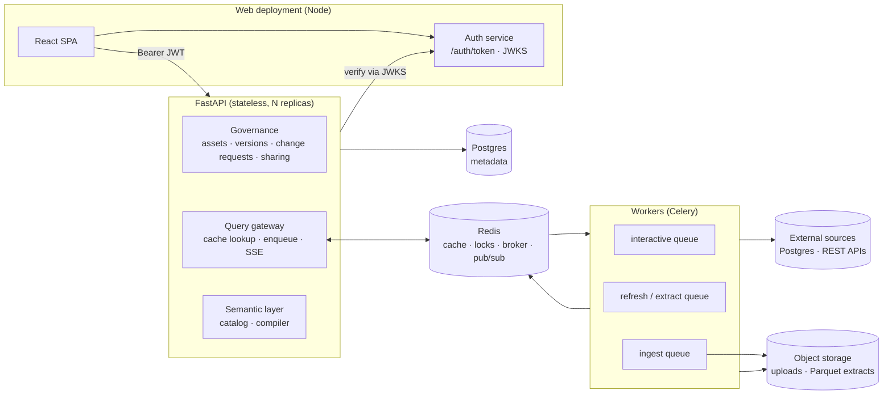
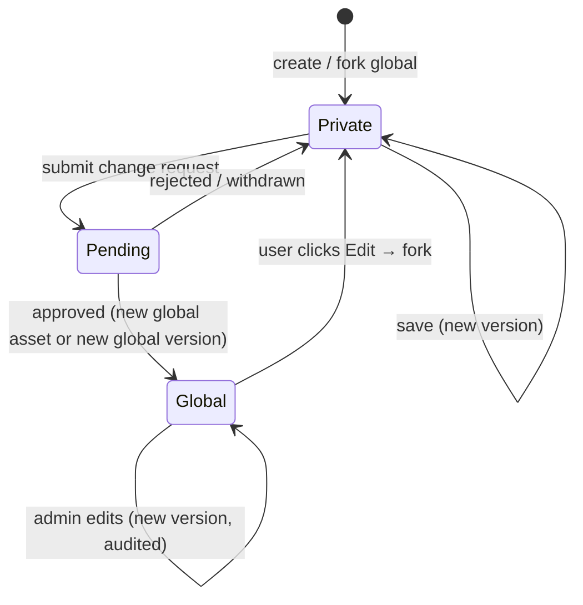
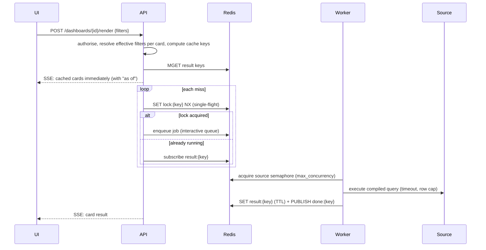

# SpendBoard v2 — Architecture & Design

Status: **Draft for review** · Branch: `feature/governance-versioning-datasources`

This document turns the POC (Express + SQLite, single dataset, no auth) into a governed,
multi-source, multi-user analytics platform. It is the reference for the implementation phases
at the end.

---

## 1. Requirements

| # | Requirement | Decision |
|---|---|---|
| R1 | Cards, dashboards **and data sources** are versioned | Immutable versions; every save appends a new one |
| R2 | Private space per user; global (public) repository | `scope = private \| global` on every asset |
| R3 | Users and admins can edit | Users edit their private assets; admins can edit global assets directly |
| R4 | Editing a global asset | **Always forks to a private copy.** Saving the copy, the user can *propose changes* — a pull-request-style change request through the same approval flow |
| R5 | Publish private → global | Change request → admin approve / reject |
| R6 | Admin approval screen | Queue of pending requests, diff vs current global version, approve / reject with comment, history |
| R7 | Dashboards pin card versions | Dashboard versions pin card versions; UI shows **"update available"** when a newer card version exists; owner/admin applies it (creates a new dashboard version) |
| R8 | Sharing | Private / global now; **share a private asset with specific users as `view` or `edit`**; team sharing later |
| R9 | Auth | Simulated SSO: the frontend Node deployment issues a signed token; UI sends it on every request; FastAPI verifies it |
| R10 | Filters | Parent–child (cascading) **and** override levels (dashboard → card) |
| R11 | Data sources | Postgres, REST API, CSV, Excel, JSON. Users onboard privately; publishing to global needs approval; admins add to global directly; versioned like cards |
| R12 | Stack | Python **FastAPI**, Postgres, Redis, worker queue |
| R13 | Scale | 1000+ concurrent users, ~10+ cards/dashboard, each card its own SQL or API call, sources may be huge and slow |
| R14 | Future LLM analytics | LLM answers questions about a dashboard without receiving raw data: **semantic layer + tool calls** executed on our side |

---

## 2. System overview



**Key principle:** no request thread ever talks to a data source. The API serves results from
cache or hands work to workers, and streams results back as they finish.

---

## 3. Authentication (simulated SSO)

Modelled on real OIDC so it can be swapped for Okta / Azure AD by changing config only.

- **Auth service** (Node, part of the web deployment):
  - `GET /auth/users` — demo users to pick from (stands in for the IdP login page)
  - `POST /auth/token {user_id}` — issues an **RS256 JWT**: `iss, aud, sub, email, name, roles, exp (1h)`
  - `GET /auth/.well-known/jwks.json` — public key
- **SPA** keeps the token in memory (+ `sessionStorage` for reload) and sends `Authorization: Bearer <jwt>`.
- **FastAPI** dependency `current_user`: verifies signature via cached JWKS, checks `iss/aud/exp`,
  then **JIT-provisions** the user row by `sub` (as with real SSO). Role comes from the `roles` claim.

---

## 4. Governance model

### 4.1 One versioning engine for three asset kinds

Cards, dashboards and data sources share the same lifecycle, so they share one implementation.
Kind-specific content lives in a typed, Pydantic-validated `spec` (JSONB).

```
users               id, sub (unique), email, name, role[user|admin], created_at

assets              id, kind[data_source|card|dashboard], scope[private|global],
                    owner_id → users,            -- creator for private; null for global (org-owned)
                    name, description,
                    head_version_id → asset_versions,
                    forked_from_asset_id, forked_from_version_id,   -- lineage for PR-style updates
                    created_at, updated_at, archived_at

asset_versions      id, asset_id, version_no, spec JSONB, spec_schema, change_note,
                    created_by, created_at          UNIQUE(asset_id, version_no)   -- immutable

asset_dependencies  version_id → asset_versions, depends_on_asset_id, depends_on_version_id
                    -- card version → data-source version; dashboard version → card versions

asset_shares        asset_id, grantee_type[user] (team later), grantee_id,
                    permission[view|edit], granted_by, created_at

change_requests     id, status[pending|approved|rejected|withdrawn], title, description,
                    requested_by, reviewed_by, review_comment, created_at, decided_at

change_request_items id, request_id, type[publish_new|update_existing],
                    source_asset_id, source_version_id,       -- the user's private version
                    target_asset_id (null for publish_new),   -- the global asset
                    base_version_id,                          -- global version the fork started from
                    result_version_id                         -- global version created on approval

audit_events        id, actor_id, action, asset_id, version_id, request_id, payload JSONB, at

secrets             id, owner_id, ciphertext (Fernet / KMS envelope), created_at, rotated_at
file_objects        id, uploaded_by, storage_key, format, size, checksum,
                    parquet_key, inferred_schema JSONB, status
```

Versions are never updated or deleted. "Restore version 3" appends a new version with v3's spec.

### 4.2 Lifecycle



- **Create** → private asset v1, owned by the user.
- **Edit a global asset (user)** → `fork`: a private copy whose `forked_from_*` records lineage.
  The user saves freely, then **Propose changes** → a `change_request` with an `update_existing` item
  (`base_version_id` = the global version they forked from).
- **Publish a new private asset** → `publish_new` item. On approval a **new global asset** is created
  and the user's private asset becomes a fork of it, so later edits are proposed as updates.
- **Admin** creates/edits global assets directly (new version, audit event, no request).
- **Stale base → PR-style merge:** if the global asset moved after the fork, approval works like
  merging a pull request (§4.6): non-conflicting changes merge automatically; conflicts block approval
  until the proposer resolves them.

### 4.3 Dependencies & bundled publishing

A card depends on a data source; a dashboard depends on cards. Publishing must not leave a global
asset pointing at a private one, so **a change request carries the private dependency closure as a
bundle** — e.g. publishing a dashboard with two private cards on a private CSV source creates one
request with four items. Approval is all-or-nothing in one transaction: global copies are created in
dependency order and references rewritten to the new global versions.

### 4.4 Dashboard pinning & "update available"

A dashboard version pins `card_version_id`s (and a card version pins its data-source version).
Editing a card therefore never changes a dashboard silently.

- `GET /dashboards/{id}/updates` lists pinned items whose asset has a newer head version
  (for global cards = newer approved version).
- UI shows a badge per card and a banner "3 card updates available — review".
- **Apply** creates a new dashboard version with bumped pins (owner for private; admin for global,
  or a user forks + proposes). The card renders a preview of old vs new before applying.

### 4.5 Permissions

| Action | Private (owner) | Shared: `view` | Shared: `edit` | Global (user) | Global (admin) |
|---|---|---|---|---|---|
| View / render | ✅ | ✅ | ✅ | ✅ | ✅ |
| Save new version | ✅ | — | ✅ | — (fork) | ✅ |
| Restore version | ✅ | — | ✅ | — | ✅ |
| Fork | ✅ | ✅ | ✅ | ✅ | ✅ |
| Share / change sharing | ✅ | — | — | n/a | n/a |
| Submit change request | ✅ | — | — | — | n/a |
| Approve / reject | — | — | — | — | ✅ |
| Archive | ✅ | — | — | — | ✅ |

Every version records `created_by`, so edits by collaborators are attributable. Only the owner
publishes or shares; sharing is revocable and takes effect immediately.

Admins see private assets only through change requests submitted to them.
**Note:** sharing a card whose data source is private lets the viewer *execute that card's query*
with the owner's source credentials — never ad-hoc queries against the source.

### 4.6 Merging change requests (PR semantics)

Specs are JSON, so merging is a **structural three-way merge** keyed by JSON path, with array items
matched by stable ids (dashboard items by `item_id`, filters by `id`, semantic-model entries by `name`):

- **base** = global version the fork started from (`base_version_id`)
- **ours** = proposed private version · **theirs** = current global head

| Situation | Result |
|---|---|
| Global unchanged since fork | Fast-forward — proposed spec becomes the new global version |
| Both changed, different paths | Auto-merged; the review screen shows the merged result and preview |
| Both changed the same path differently | **Conflict** — approve is disabled; the request shows `conflicts` |
| Text fields (e.g. raw SQL) changed on both sides | Line-level three-way merge; overlapping hunks are conflicts |

**Resolving:** the proposer clicks *Update from global* on their fork. The same merge runs into
their private copy; clean paths apply, conflicting paths are presented side-by-side (keep mine / take
global / edit). Saving creates a new private version whose `base_version_id` is the current global
head, and the open request is updated to it — exactly like pushing a merge commit to a PR branch.
A request is always re-checked for conflicts at approval time, since global may move again while it
waits in the queue.

---

## 5. Data sources

### 5.1 Connectors

A connector implements one interface, so the query engine, filters and LLM tools are source-agnostic:

```python
class Connector(Protocol):
    async def test_connection(self) -> None: ...
    async def introspect(self) -> SourceSchema: ...                # tables / fields / types
    async def execute(self, q: CompiledQuery, limits: Limits) -> ArrowTable: ...
    async def distinct_values(self, dim: Dimension, where: Filters, limit: int) -> list: ...
```

| Type | Execution | Notes |
|---|---|---|
| **Postgres** | Push-down SQL (live) or scheduled extract | Read-only DB role required; `statement_timeout`; server-side cursor; row cap |
| **REST API** | Always **extract**: fetch → normalise to Arrow → Parquet → query with DuckDB | Auth (API key / bearer / basic), pagination, JSONPath record selector, rate limit, TTL |
| **CSV / Excel / JSON** | Upload → ingest job → Parquet → DuckDB | Schema inference + user confirmation; each re-upload = new data-source version |

Credentials live in `secrets` (encrypted) and are referenced by id from the spec — never returned
to the client, never stored in versions. Rotating a secret does not create a new version (audited).

### 5.2 Data-source spec (versioned)

```jsonc
{
  "type": "postgres",
  "connection": { "host": "...", "db": "...", "user": "...", "secret_ref": "sec_123" },
  "execution": { "mode": "live", "max_concurrency": 5, "timeout_s": 30, "cache_ttl_s": 900 },
  "refresh":   { "schedule": "0 * * * *" },          // for extract mode
  "semantic_model": { ... }                           // §6
}
```

---

## 6. Semantic layer (foundation for builder, filters, scale and LLM)

Every data-source version carries a **semantic model**: business names and descriptions over
physical fields.

```yaml
datasets:
  - name: transactions
    table: public.transactions          # or API endpoint / file
    description: Card charge transactions
    time_dimension: { name: txn_date, grains: [day, month, quarter, year] }
    dimensions:
      - { name: segment,     column: segment,     type: string, description: "Business segment" }
      - { name: sub_segment, column: sub_segment, type: string }
      - { name: industry,    column: industry,    type: string, synonyms: [sector] }
      - { name: merchant,    column: merchant,    type: string }
      - { name: country,     column: country,     type: string }
    measures:
      - { name: total_spend, expr: "SUM(amount)", format: currency, description: "Charge volume" }
      - { name: txn_count,   expr: "COUNT(*)" }
hierarchies:
  - { name: segment_tree, levels: [segment, sub_segment] }
  - { name: industry_tree, levels: [industry, sub_industry] }
```

- On onboarding, `introspect` proposes a draft model; the user edits it.
- Cards are **semantic queries** (`measures`, `dimensions`, `filters`, `time_range`, `sort`, `limit`)
  compiled by the backend to dialect SQL (Postgres / DuckDB) with **SQLGlot**.
- Raw-SQL cards remain for power users: validated by SQLGlot (single read-only `SELECT`), with filters
  injected as **bound parameters** (`{{ filter.segment }}`), never string concatenation — replacing
  today's `{{filters}}` text substitution.
- The same catalog powers the builder dropdowns, filter options and LLM tools.

---

## 7. Filters: hierarchy and override levels

### 7.1 Parent–child (cascading)

Dashboard spec declares filter controls bound to semantic dimensions:

```jsonc
"filters": [
  { "id": "seg",  "dimension": "segment",     "label": "Segment",     "multi": false, "default": "ALL" },
  { "id": "sub",  "dimension": "sub_segment", "label": "Sub-segment", "multi": true,  "parent": "seg" },
  { "id": "per",  "dimension": "txn_date",    "type": "period", "default": "ytd", "locked": false }
]
```

- Child options = `distinct_values(child, where = parent selections)` — cached in Redis.
- Changing a parent drops child selections no longer valid.
- Hierarchies from the semantic model can auto-create parent/child pairs.

### 7.2 Override levels

```
effective(card, filter) =
    card-level control value      (if card exposes that control AND dashboard filter not locked)
 ?? dashboard filter value        (what the viewer selected)
 ?? dashboard filter default
 ?? no filter
```

- `locked: true` on a dashboard filter prevents card overrides.
- Card overrides reset when the dashboard-level value changes (current POC behaviour, kept).
- **Cross-source binding:** a dashboard filter targets a *dimension name*. Each card binds it to a
  dimension in its own source (by name, or explicit mapping in the card spec). Cards that can't bind
  a filter render a "filter not applied" badge instead of silently ignoring it.

---

## 8. Query execution at scale

### 8.1 Load estimate

1000 users × 10 cards = up to **10k card executions** per wave. Most users view the same popular
dashboards with default filters, so the number of *distinct* queries is far smaller — if requests
are deduplicated and cached. That is the core of the design.

### 8.2 Request flow



### 8.3 Mechanisms

| Mechanism | Purpose |
|---|---|
| **Result cache** key = `hash(card_version, source_version, canonical(effective filters))` | Identical views share one execution across **all users** (no row-level security, so results are user-independent; permission is checked before serving); key is safe because versions are immutable |
| **Single-flight lock** | 500 users opening the same dashboard → one query per card, not 500 |
| **Stale-while-revalidate** | Serve last result instantly with "as of 10:42", refresh in background |
| **Per-source semaphore + timeout + circuit breaker** | A slow or failing source can't exhaust workers or hammer the source |
| **Separate queues**: `interactive`, `refresh`, `ingest` (+ `llm` later) | Heavy extracts never starve interactive card loads |
| **Dashboard render via SSE** | One request per dashboard instead of 10+, cards paint as they arrive |
| **Result size cap** (rows/bytes); only aggregated results stored | Cards are small aggregates; raw rows never cross the wire |
| **Extracts** (Parquet + DuckDB) for REST/files, optional for huge Postgres | Interactive queries hit our fast local copy, not the slow source |
| **Pre-aggregations** (later) for global dashboards: rollup at the grain of the dashboard's filter dimensions × time grain | Filter changes are served from the rollup — the answer to "huge source, slow SQL" |
| **Scheduled warm-up** of popular dashboards' default filter state | First visitor in the morning doesn't pay the cold cost |

API replicas are stateless; workers scale per queue. Postgres holds only metadata (small).

---

## 9. LLM analytics — dashboard assistant

The LLM never receives raw data. It receives **context** and **tools**, and every tool runs through
the same governed query engine with the asking user's permissions.

**Context** (small): dashboard name/description, each card's name, description, semantic query,
effective filters, and its already-aggregated result (top-N rows, capped) — plus the semantic catalog
(measure/dimension names, descriptions, synonyms, hierarchies) of the sources on the dashboard.

**Tools:**

| Tool | Does |
|---|---|
| `list_catalog(source?)` | Measures, dimensions, hierarchies, descriptions |
| `get_dimension_values(dimension, search?)` | Valid filter values (cached) |
| `run_semantic_query(measures, dimensions, filters, time_range, limit)` | Compiled + executed by our engine; same cache/limits/permissions; returns ≤ N rows |
| `get_card_data(card_id, filters?)` | Re-run a dashboard card with different filters |

Because the semantic layer, cache and execution engine are shared, LLM queries benefit from
extracts/pre-aggregations and can't bypass access control or run unbounded SQL.

**As built (phase 6):** a floating assistant on each dashboard. The model is called in the **OpenAI
chat-completions format** (function calling) so the same code serves Ollama in development and Azure
OpenAI in production; `LLM_PROVIDER=offline` answers common questions without a model. Tools are
`query_data`, `list_dimension_values`, `get_card` and `suggest_filter` (proposes a filter button; never
applies it). Tools are scoped to the sources the dashboard's cards use, run with the asking user's
access, and return ≤50 aggregated rows. Card names, descriptions and tool results are presented to the
model as data, and the system prompt tells it to treat instructions inside them as text. Each question
is rate-limited per user and audited (question length and tools used; answers aren't stored).

---

## 10. API surface (FastAPI)

```
Auth (Node web service)
  GET  /auth/users                    POST /auth/token        GET /auth/.well-known/jwks.json

Identity
  GET  /api/me

Assets — same routes for /cards, /dashboards, /data-sources
  GET    /api/{kind}?scope=private|global|shared
  POST   /api/{kind}                          create private v1
  GET    /api/{kind}/{id}                     head version
  GET    /api/{kind}/{id}/versions            history
  GET    /api/{kind}/{id}/versions/{n}
  POST   /api/{kind}/{id}/versions            save new version (owner, or admin on global)
  POST   /api/{kind}/{id}/restore/{n}
  POST   /api/{kind}/{id}/fork
  GET    /api/{kind}/{id}/diff?from=&to=
  POST   /api/{kind}/{id}/shares             DELETE /api/{kind}/{id}/shares/{user_id}
  DELETE /api/{kind}/{id}                     archive

Change requests
  POST /api/change-requests                   submit (dependency closure bundled automatically)
  GET  /api/change-requests?status=&mine=     admin queue / my requests
  GET  /api/change-requests/{id}              items + diffs + previews
  POST /api/change-requests/{id}/approve|reject|withdraw

Dashboards
  GET  /api/dashboards/{id}/updates           card versions available
  POST /api/dashboards/{id}/apply-updates
  POST /api/dashboards/{id}/render            SSE stream of card results

Data
  POST /api/files                             upload → ingest job
  POST /api/data-sources/test-connection
  POST /api/data-sources/{id}/introspect      draft semantic model
  GET  /api/data-sources/{id}/dimensions/{dim}/values?parent filters
  POST /api/cards/{id}/data                   single card (cached)
  POST /api/query/preview                     studio preview (row-capped)

Semantic (LLM-ready)
  GET  /api/semantic/catalog?dashboard_id=
  POST /api/semantic/query
```

---

## 11. Repository layout & stack

```
apps/
  web/                 React + Vite SPA (moved from client/)
    server/            Node: serves dist + /auth (token issuer, JWKS)
backend/               Python 3.12 package (uv)
  app/
    api/               FastAPI routers
    core/              config, db, auth, redis
    governance/        assets, versions, change requests, sharing, audit
    connectors/        postgres, rest, file
    semantic/          model, compiler (SQLGlot), filters
    execution/         cache, single-flight, render/SSE
    worker/            Celery app + tasks (interactive, refresh, ingest)
  alembic/
  tests/
infra/docker-compose.yml   postgres, redis, minio, api, worker, web
docs/architecture.md
```

**Python:** FastAPI, Pydantic v2, SQLAlchemy 2 (async) + asyncpg, Alembic, Celery 5 (Redis broker),
redis-py (asyncio), SQLGlot, DuckDB, PyArrow, openpyxl, httpx, PyJWT[crypto], cryptography, pytest.
**Infra:** Postgres 16, Redis 7, MinIO (S3-compatible; local volume acceptable in dev).
**Load testing:** Locust, 1000 simulated users.

The existing Express server is retired. The 60k demo transactions move into a Postgres
`demo_warehouse` database registered as a **global Postgres data source** with a semantic model;
the existing cards and the Enterprise Spend Overview dashboard are migrated as global v1 assets.

---

## 12. Implementation phases

| Phase | Scope | Exit criteria |
|---|---|---|
| **0. Foundation** | Repo restructure, docker-compose, FastAPI skeleton, Alembic, Node auth service + JWT verification, demo users, demo warehouse seeded | `docker compose up` → log in as user/admin, existing dashboard renders via FastAPI |
| **1. Versioned assets** | assets/versions/dependencies for all 3 kinds, private/global/shared scopes, version history + restore + diff UI, sharing with users | Users have private libraries; history works; sharing works |
| **2. Governance** | Fork-on-edit, change requests with bundles, admin approval screen (queue, diff, preview, approve/reject), audit log, "update available" on dashboards | Full PR-style flow end-to-end |
| **3. Data sources** | Connectors (Postgres, REST, CSV/Excel/JSON), secrets, ingest to Parquet, introspection, semantic model editor | Onboard each type privately, publish via approval |
| **4. Query engine & filters** | Semantic compiler, parameterised raw SQL, filter hierarchy + override resolution, cascading options | Cross-source dashboards with cascading filters |
| **5. Scale** | Redis cache, single-flight, Celery queues, per-source limits, SSE render, stale-while-revalidate, scheduled refresh/warm-up; Locust test | 1000 virtual users on a 10-card dashboard; p50/p95 baseline recorded for cached and cold renders |
| **6. LLM-ready** | Catalog + semantic query endpoints shaped as tools, context assembly | Tool endpoints usable by an LLM agent |

---

## 13. Resolved decisions

| Question | Decision |
|---|---|
| Sharing permissions | Per-share `view` or `edit` (§4.5) |
| Outdated proposals | PR-style three-way merge; conflicts must be resolved by the proposer (§4.6) |
| Performance target | As fast as possible — no fixed SLA. Design for cache-first rendering; the phase-5 load test records p50/p95 for cached and cold renders as a baseline, and regressions are tracked against it |
| Row-level access | None — every user sees the same rows of a source, so cached results are shared across users |
